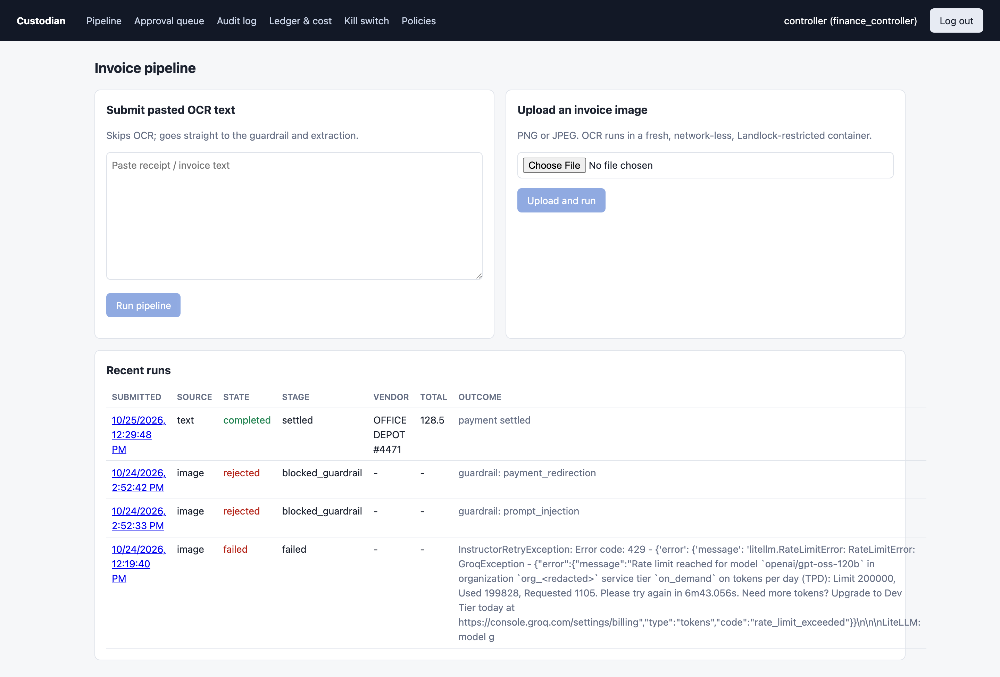
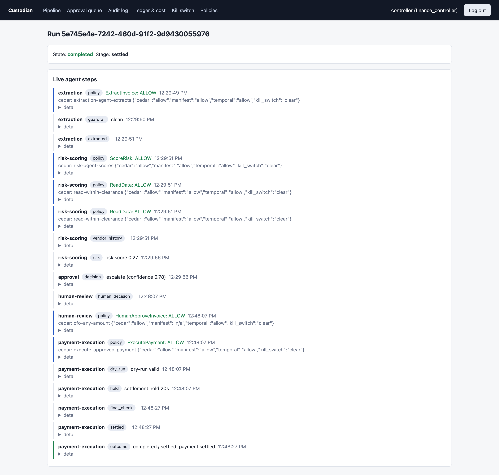
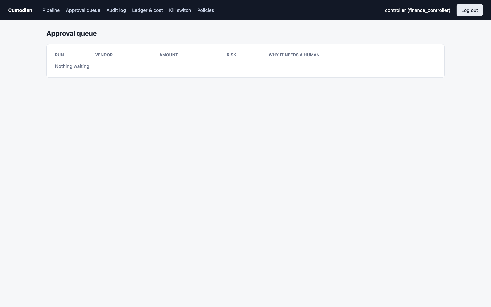
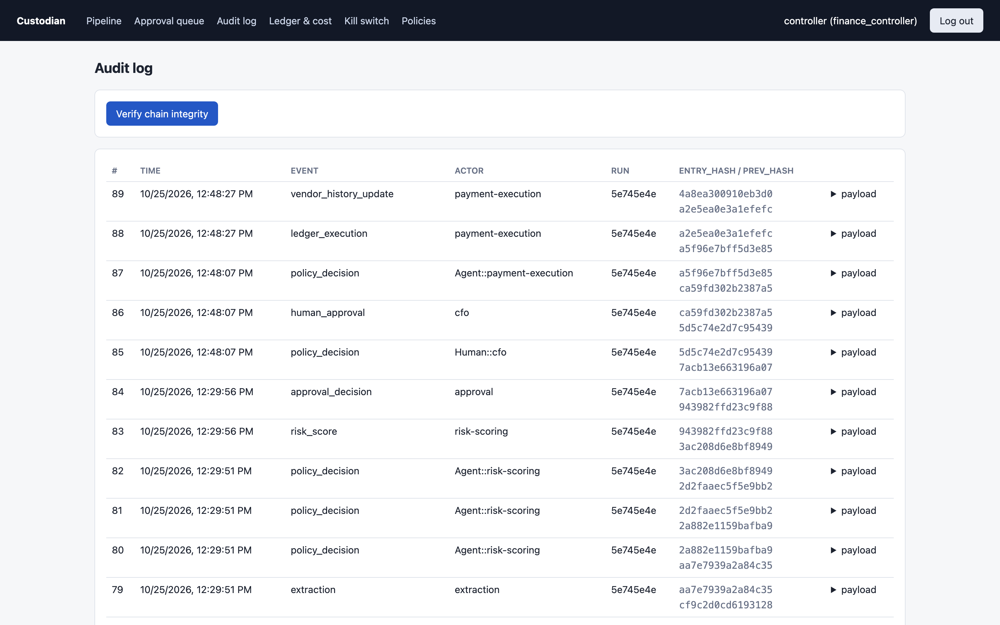
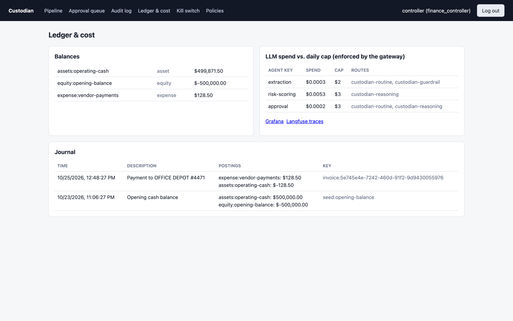
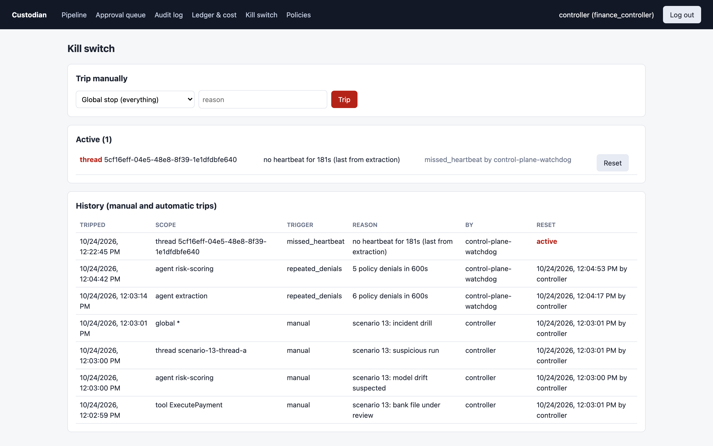
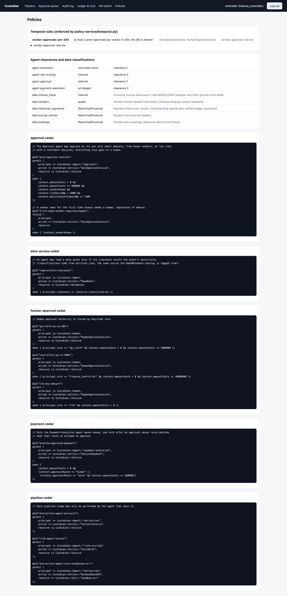
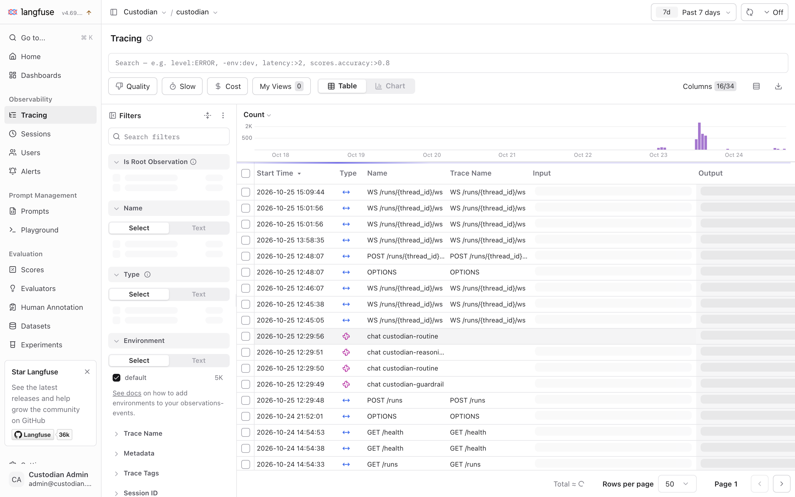
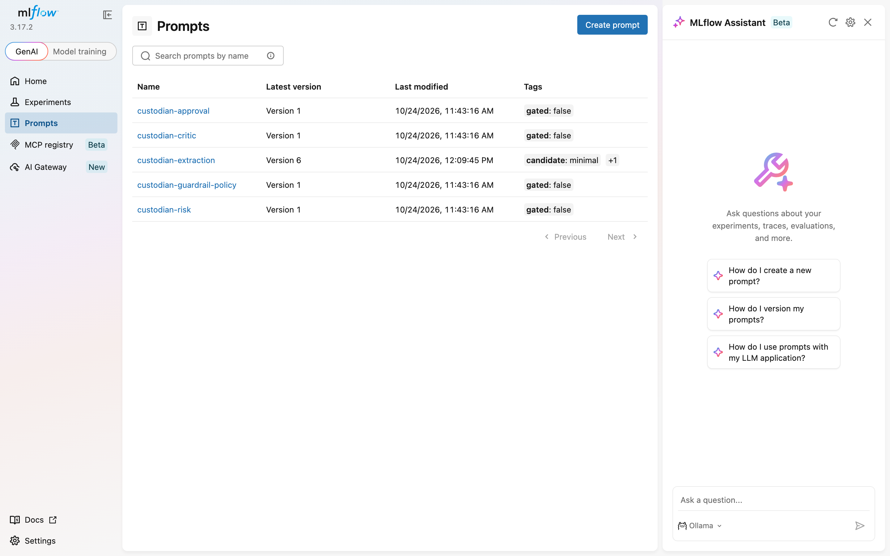
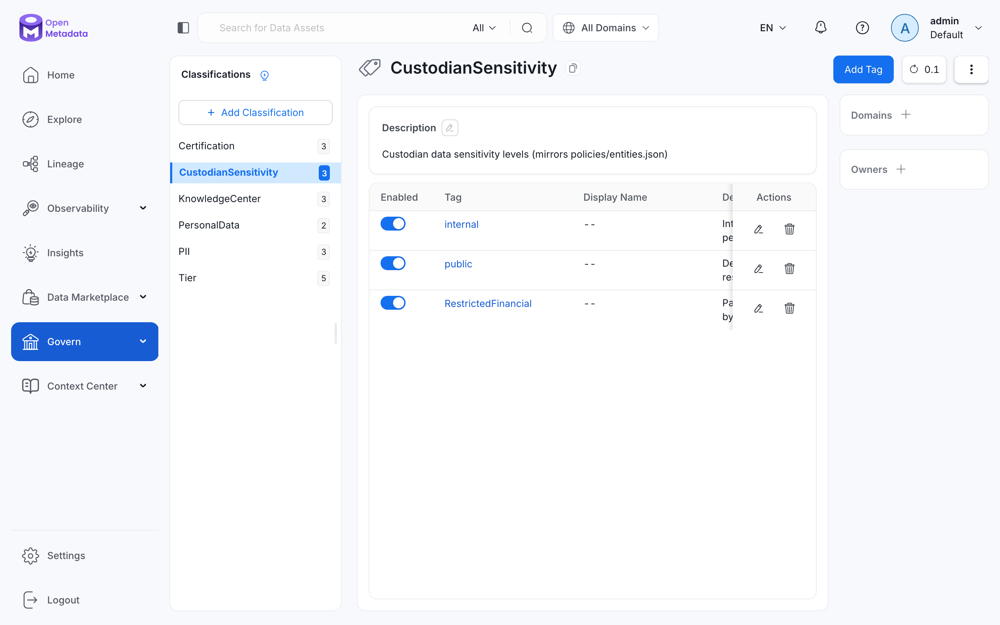

# Custodian

A governed multi-agent finance operations platform that runs entirely on your machine. Four AI agents read incoming invoices, extract and check their data, score them for fraud risk, decide whether to auto-approve or send them to a person, and pay them through an internal double-entry ledger. Around every step that touches money sit six governance layers: identity, data, model, policy, agent runtime and operations. Every one of them can be watched saying no in [`docs/scenarios/`](docs/scenarios/README.md).

The ledger is a sandboxed settlement layer, a real double-entry ledger with balance and validation logic standing in for the bank rail, the way fintech teams test settlement before going live. Invoices come from the public SROIE and CORD receipt datasets, and vendors and payment history from USAspending.gov. Nothing is mocked. The only outbound calls are to the OpenAI and Groq APIs (plus Hugging Face and USAspending when the data loader runs).

The build specification, and every place this build deviates from it or falls short, is in [`INSTRUCTIONS.md`](INSTRUCTIONS.md) under "Build decisions, deviations and honest gaps".

## Screenshots

Captured from a running local stack.

**Operator console** (http://localhost:13000)

| | |
|---|---|
|  Invoice pipeline: submit text or an image, recent runs and outcomes |  One run end to end: policy checks, guardrail, extraction, risk, escalation, human approval, settlement |
|  Approval queue for escalated invoices |  Hash-chained audit log with integrity verification |
|  Double-entry ledger balances and LLM spend against per-agent daily caps |  Graduated kill switch |
|  Cedar policies in force | |

**Supporting services**

| | |
|---|---|
|  Langfuse: traces of every API call and LLM request |  MLflow: versioned, gated agent prompts |
|  OpenMetadata: the `CustodianSensitivity` classification that mirrors `policies/entities.json` | |

## 1. Prerequisites

- **Docker Desktop** (macOS or Windows with WSL2) or Docker Engine with Compose v2.24 or later.
- **Memory.** Measured with all 23 long-running containers up and idle: **6.4 GB**. The largest are Elasticsearch 1.0 GB, OpenMetadata 0.9 GB, langfuse-web 0.6 GB, LiteLLM 0.6 GB, Infisical 0.6 GB and Keycloak 0.5 GB. Give Docker Desktop **at least 10 GB** (Settings > Resources); 8 GB works only if nothing else is running in Docker. Image builds and the prompt evaluation add temporary load on top.
- **CPU:** 4 or more cores for Docker.
- **Disk:** about 40 GB free. The images are about 22 GB, plus the build cache, the Hugging Face dataset cache and about 6 GB of volumes.
- **Host tools:** `python3` (3.10 or later, standard library only), `curl`, a POSIX `sh`.
- **Free host ports** on 127.0.0.1: 13000 to 13002, 14000, 15000, 15432, 18000, 18010, 18011, 18081, 18082, 18585, 19000, 19001, 19090. Nothing uses 8080 on purpose (see Troubleshooting).

## 2. Getting the two API keys

Only two values have to come from you. Everything else in `.env.example` is a local-only secret that is either already filled in or filled in by a script.

- **OpenAI** (the reasoning route: risk scoring, approval, critic): create a key at https://platform.openai.com/api-keys. The account needs **paid credits**: a key on an account with no credits authenticates fine and then fails every call with `You have no credits remaining`.
- **Groq** (the routine and guardrail routes: extraction, guardrail, evaluation): create a key at https://console.groq.com/keys. The free on-demand tier works, but it limits `openai/gpt-oss-120b` to 8,000 tokens a minute and 200,000 a day. One prompt-evaluation run uses most of a day's allowance.

```sh
cp .env.example .env
# edit .env: set OPENAI_API_KEY= and GROQ_API_KEY=
```
`.env` is gitignored; never commit it. The provider keys are copied into Infisical in step 4 below. From then on, LiteLLM reads them from Infisical, not from `.env`.

## 3. First run

All commands run from the repository root. `infra/scripts/compose.sh` runs Docker Compose with all six layer files (`infra/compose/docker-compose.{base,identity,data,model,app,observability}.yml`). `infra/scripts/layer.sh <layer> ...` runs one layer with only the layers it depends on.

The order below is the order this stack was actually brought up in during the build. It was not replayed from an empty machine after the final changes.

1. **Keycloak realm.** Fills the realm template from `.env`:
   `sh infra/scripts/render-keycloak-realm.sh`
2. **Base services** (Postgres, MinIO, Redis). Wait until all report healthy. The bucket set-up job `minio-init` runs automatically before the services that need it.
   `sh infra/scripts/compose.sh up -d --wait postgres minio redis`
3. **SPIRE.** Generates a single-use join token, writes it to `.env`, starts the server and agent, then registers the six workload entries (each with a 1-hour SVID TTL):
   ```sh
   sh infra/scripts/setup-spire.sh            # ends with: spire-agent restarted with the new token
   sh infra/scripts/register-spire-entries.sh
   ```
4. **Infisical.** Creates the admin, exchanges and revokes the bootstrap token, then creates one project per secret scope and four narrow machine identities. Both scripts write IDs and secrets into `.env`.
   ```sh
   sh infra/scripts/compose.sh up -d --wait keycloak infisical
   sh infra/scripts/bootstrap-infisical.sh
   python3 infra/scripts/provision-infisical-identities.py   # expect: stored secret custodian-llm-providers/OPENAI_API_KEY ...
   ```
5. **Sandbox image.** Not a compose service; the sandbox runner starts one container from it per invoice:
   `docker build -t custodian/sandbox-ocr:local custodian-sandbox-ocr`
6. **Data.** Start the catalog, load the real data, then register the catalog. The first load downloads SROIE and CORD from Hugging Face and 1,000 awards from USAspending, and takes several minutes; wait for `great expectations checkpoint over 1187 invoice records`. That line says FAILED, because the real data has real defects (scenario 05).
   ```sh
   sh infra/scripts/layer.sh data up -d --wait openmetadata
   sh infra/scripts/layer.sh data run --rm custodian-data-loader
   python3 infra/scripts/register-openmetadata-catalog.py
   ```
7. **Model gateway and registry.** Then create one LiteLLM virtual key per agent (written to `.env`), and run the prompt promotion gate. The gate takes about 20 minutes on Groq's free tier; wait for `PROMOTED: custodian-extraction vN`.
   ```sh
   sh infra/scripts/compose.sh up -d --wait litellm mlflow
   python3 infra/scripts/provision-litellm-keys.py
   sh infra/scripts/compose.sh --profile jobs run --rm --build prompt-eval
   ```
8. **Everything else** (policy service, control plane, audit log, ledger, sandbox runner, backend, console, Langfuse, Prometheus, Grafana):
   `sh infra/scripts/compose.sh up -d --build --wait`
9. **Sample invoices** for the scenarios, rendered from real vendor data:
   `sh infra/scripts/layer.sh data run --rm --no-deps -v "$PWD/docs/sample-invoices:/work" --entrypoint python custodian-data-loader /work/generate.py`

Then run the check in section 5 and start with [`docs/scenarios/README.md`](docs/scenarios/README.md).

## 4. Services

All URLs bind to 127.0.0.1. The credentials are local-development values from `.env`; see [`CREDENTIALS.md`](CREDENTIALS.md) for the full list.

| Service | URL | Login |
|---|---|---|
| Custodian console | http://localhost:13000 | `clerk` / `controller` / `cfo`, passwords `KC_*_PASSWORD` |
| Backend API | http://localhost:18000 | none for reads and submission; Keycloak token for decisions |
| Ledger API | http://localhost:18010 | `X-API-Key` from Infisical (scenario 18) |
| Control plane (kill switch) | http://localhost:18011 | Keycloak token with `finance_controller` or `cfo` |
| Keycloak | http://localhost:18081/admin | `admin` / `KEYCLOAK_ADMIN_PASSWORD` |
| Infisical | http://localhost:18082 | `INFISICAL_ADMIN_EMAIL` / `INFISICAL_ADMIN_PASSWORD` |
| LiteLLM | http://localhost:14000 | bearer `LITELLM_MASTER_KEY` |
| MLflow | http://localhost:15000 | none |
| OpenMetadata | http://localhost:18585 | `admin@open-metadata.org` / `admin` |
| Langfuse | http://localhost:13001 | `LANGFUSE_ADMIN_EMAIL` / `LANGFUSE_ADMIN_PASSWORD` |
| Grafana | http://localhost:13002 | `admin` / `GRAFANA_ADMIN_PASSWORD` |
| Prometheus | http://localhost:19090 | none |
| MinIO console | http://localhost:19001 | `MINIO_ROOT_USER` / `MINIO_ROOT_PASSWORD` |
| Postgres | 127.0.0.1:15432 | `postgres` / `POSTGRES_PASSWORD` |

The policy service, audit log and sandbox runner publish no host port; reach them with `infra/scripts/call.sh <service> <METHOD> <path> [json]`.

## 5. Confirm everything is up

```sh
python3 infra/scripts/check-stack.py
```
Checklist (each line is a check the script runs):
- every long-running container is running and healthy, and every one-shot job exited 0
- the Keycloak realm `custodian` exists and `controller` gets a token carrying `finance_controller`
- the backend holds a live SPIRE SVID, and its prompts came from MLflow, not the bundled fallback
- the payment identity can read the ledger key from Infisical
- OpenMetadata has all 5 tables tagged `CustodianSensitivity.*`
- the Cedar policies validate (schema, lint, temporal rule, 26-case matrix)
- LiteLLM reaches OpenAI (`custodian-reasoning`) and Groq (`custodian-routine`, `custodian-guardrail`), with one tiny real call each
- the loader's counts: SROIE train/test, CORD validation/test, vendors and historical payments
- the audit chain verifies at both stages

Real output on the build machine (the reasoning route fails because that OpenAI account had no credits):
```
PASS  containers running and healthy     23 running
PASS  Keycloak realm and operator login  realm=custodian, controller token roles=['finance_controller']
PASS  backend SVID (SPIRE)               spiffe://custodian.local/service/custodian-backend, 2360s remaining
PASS  prompts loaded from MLflow         extraction=mlflow:custodian-extraction@production (v5)
PASS  Infisical secret brokering         payment identity reads LEDGER_API_KEY -> 200, token TTL 300s
PASS  OpenMetadata catalog               5/5 tables tagged: ['historical_payments', 'invoice_inbox', 'journal_entries', 'postings', 'vendors']
PASS  Cedar policies validate            ACCEPTED (26 matrix cases)
FAIL  LiteLLM custodian-reasoning        HTTP 429: litellm.RateLimitError: RateLimitError: OpenAIException - You have no credits remaining. ...
PASS  LiteLLM custodian-routine          custodian-routine answered, 133 tokens
PASS  LiteLLM custodian-guardrail        custodian-guardrail answered, 106 tokens
PASS  invoices loaded (SROIE, CORD)      cord/test=100 cord/validation=100 sroie/test=361 sroie/train=626
PASS  vendor master (USAspending)        115 vendors, 1001 historical payments
PASS  audit chain verifies               76 entries, findings: []
```

To run one invoice and follow it: `python3 infra/scripts/run-invoice.py docs/sample-invoices/out/01-routine-known-vendor.png`

## 6. Troubleshooting

Each entry is a failure that actually happened while building this, with its real message.

**`join token does not exist or has already been used`** (spire-agent crash-loops), and then the backend restart-loops with
`FATAL: could not obtain an X.509-SVID from the SPIRE Workload API: Invalid WorkloadApiClient configuration: SPIFFE socket file "/run/spire/sockets/agent.sock" does not exist.` (exit code 70).
The agent's own identity expired (here, after the Docker VM stalled for hours) and the join token in `.env` is single-use. Run `sh infra/scripts/setup-spire.sh`. It issues a new token, retires the old agent record, recreates the agent's data volume, and the backend recovers on its own. This is the fail-closed design working (scenario 02).

**LiteLLM exits right after start, with an Infisical error while fetching provider keys.** `OPENAI_API_KEY` or `GROQ_API_KEY` was empty when `provision-infisical-identities.py` ran, which prints `warning: OPENAI_API_KEY is empty in .env - set it and re-run this script`. Set them, re-run the script, then `sh infra/scripts/compose.sh up -d --wait litellm`. LiteLLM deliberately refuses to start without its keys.

**`You have no credits remaining`** from `custodian-reasoning`: the OpenAI account needs paid credits. Risk scoring, approval and the critic all use this route; there is deliberately no fallback to Groq (scenario 08).

**`Rate limit reached for model openai/gpt-oss-120b ... on tokens per minute (TPM): Limit 8000`** or **`... tokens per day (TPD): Limit 200000`**: Groq's free tier. The LLM wrapper waits out short limits automatically. A daily limit fails the step immediately; wait for the rolling window, or upgrade the Groq tier.

**Everything is slow, `docker` commands take minutes, Langfuse never becomes healthy.** The Docker VM is out of memory or CPU. On the build machine, another project's 12 containers shared an 8 GB VM; removing them brought the stack to 5.9 GB. Raise Docker Desktop's memory (section 1) or stop other containers.

**`audit log unavailable; an unaudited allow is not permitted`** on decisions that should be allowed, or MinIO taking seconds per request. Something is starving MinIO of CPU. On the build machine it was ClickHouse at about 230% CPU while idle, doing its own self-monitoring; `infra/clickhouse/*.xml` switches that off. Check `docker stats`.

**langfuse-web restarting with `FATAL ERROR: Reached heap limit Allocation failed - JavaScript heap out of memory`**, or Langfuse containers stuck `unhealthy` while their logs look fine. The compose file now sets `NODE_OPTIONS=--max-old-space-size=1024` and `HOSTNAME=0.0.0.0`. Without the latter, both Langfuse containers listen only on the container IP and their localhost health check can never pass.

**A service shows healthy but its port does not answer** (after a Docker Desktop or WSL restart): `sh infra/scripts/compose.sh up -d --force-recreate <service>`.

**Langfuse errors about its database after Postgres was recreated:** its Prisma connection pool holds dead connections. Recreate both Langfuse containers: `sh infra/scripts/compose.sh up -d --force-recreate langfuse-web langfuse-worker`.

**Windows / WSL2: file mounts hang or containers will not start after sleep.** Run `wsl --shutdown` in PowerShell, start Docker Desktop again, then `sh infra/scripts/compose.sh up -d --wait`.

**Port 8080 conflicts:** nothing in this stack uses 8080, on purpose (it is the most commonly taken local port). If you add a service, keep it off 8080.

**`docker compose run` ignores your command** for an image with an `ENTRYPOINT` (the data loader, the prompt-eval job): pass `--entrypoint`, as the sample-invoice step in section 3 does.

**The data loader dies loading CORD**: building CORD's 800-image train split is killed for memory next to the rest of the stack. The loader reads only the validation and test parquet files (`CORD_SPLITS=validation,test`); do not add `train` unless Docker has memory to spare.

**MLflow restarting (OOM)**: MLflow 3.17's background job workers exceeded 768 MB. The compose file disables them (`MLFLOW_SERVER_ENABLE_JOB_EXECUTION=false`) and runs one worker in 1 GB.
